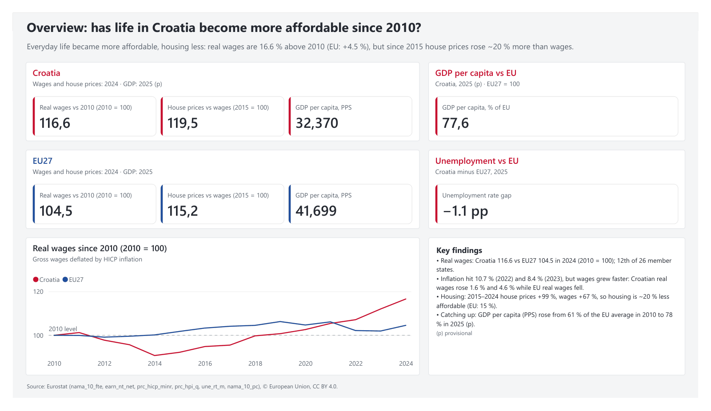
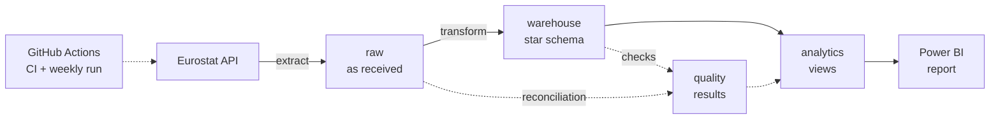
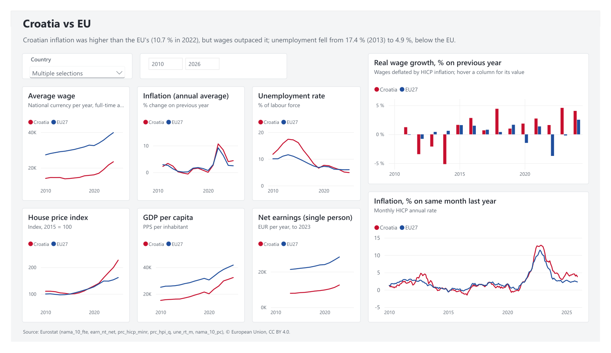
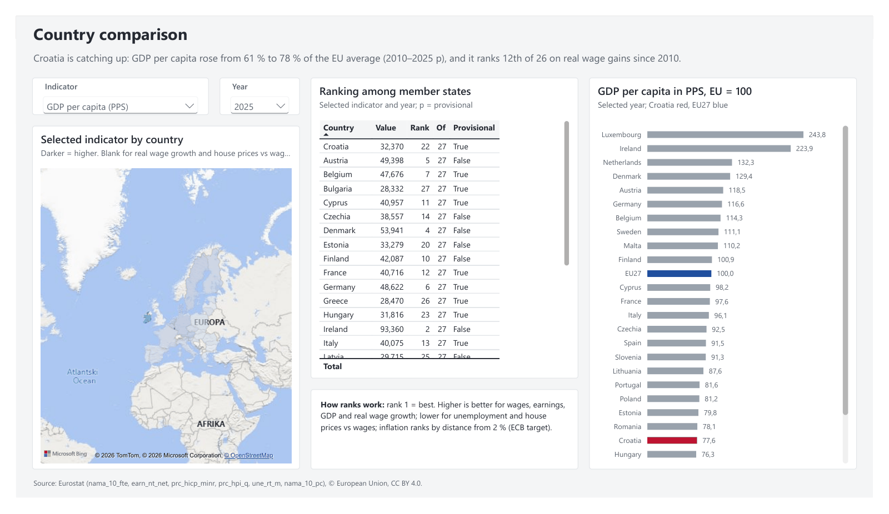
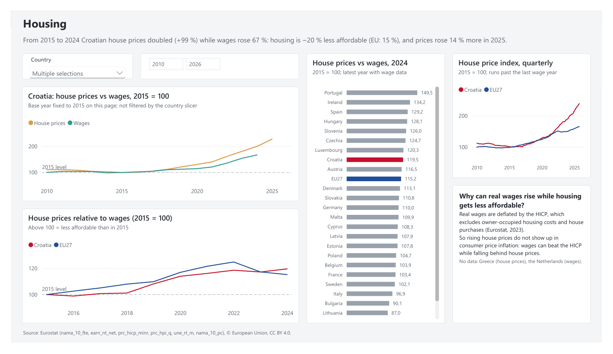
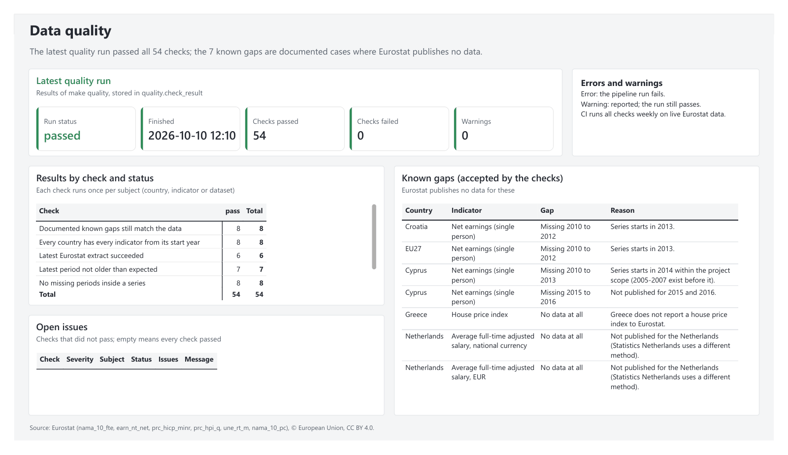

# EU Economic Dashboard

[](https://github.com/kiko4902/eu-economic-dashboard/actions/workflows/ci.yml)

A Python + SQL pipeline loads six Eurostat datasets for the 27 EU countries into a PostgreSQL
star schema, with quality checks. A Power BI report on top answers one question about
Croatia and the EU.

## The question

**Has life in Croatia (and the EU) become more or less affordable since 2010?**

**Short answer:** for everyday spending, more affordable; for housing, less. Wages grew faster
than consumer prices, but house prices grew faster than wages.

## Key findings

1. **Real wages in Croatia are 16.6 % above 2010** (index 116.6 in 2024; EU27: 104.5). Croatia
   ranks 12th of 26 member states.
2. **Wages beat the inflation shock.** Croatian inflation was 10.7 % in 2022 and 8.4 % in 2023
   (EU: 9.2 %, 6.4 %). Real wages still grew by 1.6 % and 4.6 %, while EU real wages fell
   (−3.7 %, −0.2 %).
3. **Housing became less affordable.** From 2015 to 2024 Croatian house prices rose 99 % and
   wages 67 %. House prices relative to wages are therefore at 119.5 (2015 = 100); EU: 115.2.
4. **Croatia is catching up.** GDP per capita in purchasing power standards rose from 60.7 % of
   the EU average in 2010 to 77.6 % in 2025 (provisional).
5. **Unemployment fell from 17.4 % (2013) to 4.9 % (2025)**, below the EU's 6.0 %.

Each number, with the SQL behind it, is in [docs/findings.md](docs/findings.md).



## Data decisions

- **Wage source.** Net earnings (`earn_nt_net`) have a series break in 2024: the compiler
  changed from the OECD to the Commission's JRC. All 2024 values are on a monthly scale, and
  2025 is not comparable with 2023 (Croatia +34 %). Net earnings are therefore used only up to
  2023. Wage growth uses `nama_10_fte` instead: average gross wage per full-time equivalent from
  national accounts, with no change of compiler.
- **Real wages in national currency.** Real wages = wage growth in national currency deflated
  by the same country's HICP. Using wages in EUR would add exchange-rate moves for non-euro
  countries. Euro countries are reported in euro for all years, so Croatia's 2023 changeover
  causes no jump.
- **Annual inflation from the monthly index.** `prc_hicp_manr` is discontinued, so the source is
  `prc_hicp_minr`. Annual inflation = annual average index ÷ previous year's − 1. Rounded to
  0.1, this matches Eurostat's official annual rate (`prc_hicp_ainr`) for all 420 country-years
  of 2011–2025.
- **Croatia 2022 vs the national statistics office.** DZS reported a 2.3 % *fall* in real
  wages for 2022; this project shows +1.6 %.
  - **Where the gap is:** nominal growth, 12.4 % vs 8.3 %. The price deflators are almost the
    same (10.7 % vs 10.8 %).
  - **Why:** DZS covers employees of legal entities, from tax forms. National accounts cover
    every employee and all pay.
  - **Check:** Eurostat's wage bill divided by its employee count gives +12.5 %, close to the +12.4 %.
  - Details: [findings](docs/findings.md#2-croatia-had-higher-inflation-than-the-eu-but-wages-outpaced-it-eu-real-wages-fell).
- **Why real wages and housing can diverge.** The HICP excludes owner-occupied housing and house
  purchases, so housing is measured separately: house price index ÷ wage index (2015 = 100).
- **Known gaps are documented, not hidden.** Eurostat publishes:
  - no house price index for Greece
  - no full-time adjusted wages for the Netherlands
  - net earnings for Croatia and the EU only from 2013

  These exceptions are listed in `seeds/known_gaps.csv`. The quality checks treat them as
  expected and warn if one no longer matches the data.
- **Eurostat flags are kept** (`p` provisional, `b` break, `e` estimated). The report marks
  provisional values.

Sources and filters for every dataset: [docs/data_sources.md](docs/data_sources.md).

## Architecture



| Layer | Purpose |
|---|---|
| `raw` | Eurostat data exactly as received, one table per dataset, plus a load log. Never modified in place. |
| `warehouse` | Star schema: one fact table (country × period × indicator, ~20,000 rows) and four dimensions. Idempotent loads; every skipped row is counted with a reason. |
| `analytics` | 13 SQL views for Power BI: real wages, inflation, housing affordability, GDP vs EU, country ranks, quality results. |
| `quality` | Results of every quality run; rules and known gaps come from CSV seeds. |
| Power BI | Imports the `analytics` views through a read-only database role. |

All SQL lives in `.sql` files; Python (`src/pipeline/`) only orchestrates. Detailed diagram:
[docs/images/architecture.md](docs/images/architecture.md).

## Data model

Star schema in the `warehouse` schema. `fact_observation` has one row per country × period
× indicator, with four dimensions: `dim_country`, `dim_time`, `dim_indicator` and `dim_flag`.
ER diagram: [docs/images/er_diagram.md](docs/images/er_diagram.md).

## Data quality and testing

`make quality` runs 7 checks. An **error** fails the pipeline and CI; a **warning** is only
reported. Results are stored per run and shown on the report's Data quality page. The latest
run passed all 54 checks.

| Check | Severity | Verifies |
|---|---|---|
| `load_status` | error | the latest extract of every dataset succeeded |
| `reconciliation` | error | raw rows = fact rows + rows skipped for a documented reason |
| `completeness` | error | every country has every indicator from its start year |
| `missing_periods` | error | no holes inside a series |
| `value_range` | error | values within plausible ranges |
| `known_gaps_current` | warning | the documented gaps still match the data |
| `freshness` | warning | the latest period is not older than expected |

- **Tests:** 87 pytest tests. API responses are mocked from fixtures. Database tests run inside
  a rolled-back transaction.
- **CI** ([ci.yml](.github/workflows/ci.yml)), on every push and pull request:
  1. lint and unit tests
  2. on a Postgres service container: the full pipeline against the live Eurostat API, all
     tests, and the quality checks
- **Weekly run** ([scheduled.yml](.github/workflows/scheduled.yml)), Mondays 05:00 UTC: the full
  pipeline and quality checks, to catch upstream changes such as renamed datasets or new gaps.

## Report

Five pages, built in Power BI Desktop: Overview (above), Croatia vs EU, Country comparison,
Housing and Data quality. Croatia is always red and the EU blue. Full PDF:
[powerbi/eu_dashboard.pdf](powerbi/eu_dashboard.pdf).

| Croatia vs EU | Country comparison |
|---|---|
|  |  |
| **Housing** | **Data quality** |
|  |  |

## How to run

Prerequisites:
- Docker (Docker Compose)
- [uv](https://docs.astral.sh/uv/), which installs Python 3.12 itself
- GNU make

```
cp .env.example .env    # then set the two passwords
make install up         # create .venv from uv.lock, start PostgreSQL 16
make pipeline           # extract -> warehouse -> transform -> analytics -> quality checks
```

Other targets: `make test`, `make lint`, `make quality`, `make db-shell`, `make help`.

**Open the report** in Power BI Desktop (Windows). Either:
- `powerbi/eu_dashboard.pbix`: the data is included, so no database is needed.
- `powerbi/eu_dashboard.pbip`: the same report as a Power BI project in plain text.

To refresh with new data:
1. Run `make pipeline`.
2. In Power BI Desktop, choose **Home → Refresh**.
3. Sign in as `powerbi_reader`, with the password from `.env`.

Details: [docs/powerbi_guide.md](docs/powerbi_guide.md).

## Tech stack

- **Pipeline:** Python 3.12 (pandas, requests, SQLAlchemy, psycopg), dependencies locked with uv
- **Database:** PostgreSQL 16 in Docker Compose
- **Tooling:** Makefile, pytest, ruff, GitHub Actions
- **Report:** Power BI Desktop: DAX measures, PBIP project format

## Project structure

```
src/pipeline/    extract, warehouse, transform, analytics, quality, reconciliation, run
sql/             init/ raw/ warehouse/ transform/ analytics/ quality/ roles/  (all SQL)
seeds/           dimensions, quality rules, known gaps (CSV)
tests/           pytest, API fixtures
powerbi/         report (.pbip, .pbix, PDF) and theme
docs/            findings, data sources, Power BI guide, plan, diagrams, screenshots
scripts/         dev tools (render report screenshots)
.github/         CI and scheduled workflows
```

## Data source and licence

Data: © European Union, Eurostat, licensed under
[CC BY 4.0](https://creativecommons.org/licenses/by/4.0/). Retrieved through the Eurostat API.
Datasets used:
- `nama_10_fte`
- `earn_nt_net`
- `prc_hicp_minr`
- `prc_hpi_q`
- `une_rt_m`
- `nama_10_pc`

Filters and caveats are in [docs/data_sources.md](docs/data_sources.md).
