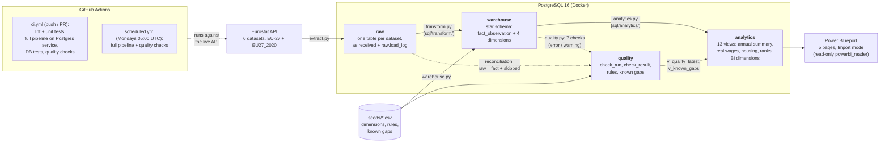

# Architecture

Data flow from the Eurostat API to the Power BI report. GitHub renders the Mermaid diagram
below. `make pipeline` (`python -m pipeline.run`) runs the steps in order.

| Layer | What it holds | Code |
|---|---|---|
| `raw` | Eurostat data exactly as received, one table per dataset, plus `load_log` (row counts, status). Never modified in place; a re-extract replaces a dataset. | `src/pipeline/extract.py`, `sql/raw/` |
| `warehouse` | Star schema: `fact_observation` (country × period × indicator) with `dim_country`, `dim_time`, `dim_indicator`, `dim_flag`. Loads are idempotent; skipped rows are counted per reason. | `src/pipeline/warehouse.py`, `transform.py`, `sql/warehouse/`, `sql/transform/` |
| `analytics` | Views for Power BI: annual summary, YoY change, real wage growth, 2015 = 100 indices, housing affordability, GDP vs EU, country ranks, BI dimensions, latest quality results. | `src/pipeline/analytics.py`, `sql/analytics/` |
| `quality` | Results of every quality run, plus the rules and documented known gaps from `seeds/`. | `src/pipeline/quality.py`, `reconciliation.py`, `sql/quality/` |
| Power BI | Imports the `analytics` views as the read-only `powerbi_reader` role. | `powerbi/` |

ER diagram of the warehouse: [er_diagram.md](er_diagram.md).
