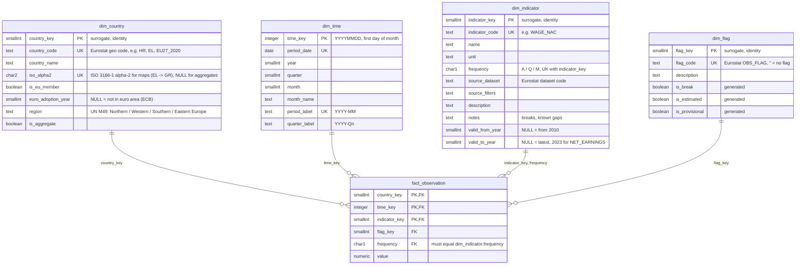

# Warehouse ER diagram

Star schema in the `warehouse` schema (DDL in `sql/warehouse/`). GitHub renders the Mermaid
diagram below.

**Grain:** one row per country × period × indicator. Annual and quarterly observations use
the `time_key` of the first month of their period (2024 → 20240101, 2024-Q2 → 20240401).
